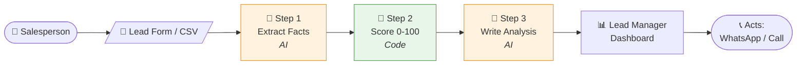

<div align="center">

# 🏢 Lead Manager

### Real Estate AI Sales Copilot & Lead Intelligence Platform

*Turn messy inbound inquiries into scored, explained, ready-to-action leads — in seconds.*

[](https://www.python.org/)
[](https://flask.palletsprojects.com/)
[](https://ai.google.dev/)
[](https://firebase.google.com/)
[](#-ai-evaluation-framework--benchmarks)
[](https://lead-manager-two-psi.vercel.app/)

[**🚀 Live Demo**](https://lead-manager-two-psi.vercel.app/) &nbsp;•&nbsp;
[**🎥 Demo Video**](https://youtu.be/tembzSdH_Ws) &nbsp;•&nbsp;
[**📊 Eval Scorecard**](#-ai-evaluation-framework--benchmarks) &nbsp;•&nbsp;
[**🏗️ Architecture**](#️-system-architecture)

<br/>


</div>

---

## 📑 Table of Contents

- [📌 Executive Summary](#-executive-summary)
- [✨ Highlights at a Glance](#-highlights-at-a-glance)
- [🏗️ System Architecture](#️-system-architecture)
- [🧮 Deterministic Scoring Engine](#-deterministic-scoring-engine)
- [🛡️ Safety, Reliability & Prompt Injection Defense](#️-safety-reliability--prompt-injection-defense)
- [💾 Storage & Resilient Data Layer](#-storage--resilient-data-layer)
- [🧰 Tech Stack](#-tech-stack)
- [🤖 AI Model & Integration Details](#-ai-model--integration-details)
- [🌟 Invented Feature: Follow-Up Automation Hub](#-invented-feature-follow-up-automation-hub--multi-channel-copy-generator)
- [📊 AI Evaluation Framework & Benchmarks](#-ai-evaluation-framework--benchmarks)
- [⚡ Key Technical Decisions](#-key-technical-decisions)
- [🚀 How to Run Locally](#-how-to-run-locally)
- [📋 Comprehensive Feature Walkthrough](#-comprehensive-feature-walkthrough)
- [⚠️ Known Limitations & Future Roadmap](#️-known-limitations--future-roadmap)
- [🤝 AI Usage Disclosure](#-ai-usage-disclosure)
- [🎥 Demo Video & Live Deployment Links](#-demo-video--live-deployment-links)

---

## 📌 Executive Summary

Real estate sales teams in high-velocity metro markets (such as **Bangalore**) receive **hundreds of digital inquiries per day** from WhatsApp, 99acres, MagicBricks, and web forms. Sales reps spend **up to 70% of their day** manually parsing unstructured messages, guessing buyer intent, and drafting repetitive replies.

**Lead Manager** is a **production-grade Real Estate Sales Copilot** built for real-world sales operations. It automates:

| # | Capability | What it does |
|:-:|---|---|
| 1️⃣ | **Instant Lead Intake & Parsing** | Single-lead ingestion and high-throughput RFC 4180 CSV batch import with duplicate detection. |
| 2️⃣ | **6-Factor Deterministic Lead Scoring** | Transparent, auditable 0–100 scoring based on Bangalore micro-market pricing benchmarks (Whitefield, Sarjapur, Electronic City, Hebbal, etc.). |
| 3️⃣ | **Structured AI Intelligence Extraction** | Google Gemini Flash extracts intent, objections, timeline triggers, and recommended next actions. |
| 4️⃣ | **Bilingual Conversational Copilot** | Context-grounded Q&A in natural English and conversational **Hinglish** — e.g., *"Saturday ko visit arrange kar sakte ho?"* |
| 5️⃣ | **🌟 Follow-Up Automation Hub** | One-click personalized WhatsApp, SMS, and call scripts tailored to the lead's urgency and objections. |
| 6️⃣ | **Rigorous AI Evaluation Suite** | A complete test battery verifying extraction accuracy, scoring agreement, hallucination resistance, metamorphic robustness, and prompt injection defense. |

---

## ✨ Highlights at a Glance

<div align="center">

| 🎯 Tag Agreement | 📉 Score MAE | 🛡️ Injection Defense | 🔁 Metamorphic Robustness | 🗣️ Languages |
|:-:|:-:|:-:|:-:|:-:|
| **94.9%** dev / **95.8%** heldout | **1.40 pts** | **15 / 15** blocked | **100%** invariance & monotonicity | **English + Hinglish** |

</div>

---

## 🏗️ System Architecture

The architecture implements the end-to-end design defined in [`architecture-professional.html`](architecture-professional.html) (interactive SVG view) and [`architecture.html`](architecture.html). It **separates probabilistic generative AI from deterministic business logic**, ensuring lead scoring and qualification remain **100% explainable and mathematically auditable**.

### System Architecture Diagram

<div align="center">
  
</div>

### Detailed Architecture Subsystems

#### 1️⃣ Salesperson Lane (End-to-End User Flow)



<details>
<summary>📄 Plain-text version of the flow</summary>

```
[Salesperson] ──> [Lead Form / CSV] ──> [Step 1: Extract Facts (AI)] ──> [Step 2: Score 0-100 (Code)] ──> [Step 3: Write Analysis (AI)] ──> [Lead Manager Dashboard] ──> [Salesperson Acts (WhatsApp / Call)]
```

</details>

- **Frictionless Ingestion** — Enter a single lead in seconds, or drag-and-drop a multi-line RFC 4180 CSV containing up to **50** inbound records.
- **Explainable Hand-off** — The AI does **not** guess the score. The code calculates the score first; the LLM then writes the summary and suggested reply with full knowledge of *why* the lead received that exact score.

---

## 🧮 Deterministic Scoring Engine

> 📁 `scoring_engine.py` / `rules.py`

Rather than treating scoring as an opaque LLM prompt, the engine evaluates **6 auditable dimensions** (100 points total):

| # | Dimension | Max | How it's scored |
|:-:|---|:-:|---|
| 1 | 💰 **Budget Fit vs. Market Baseline** | **20** | Validates stated budget against real Bangalore micro-market price floors (e.g. ₹1.3–2.2 Cr for Whitefield 3BHK, ₹75–120L for Sarjapur 2BHK). |
| 2 | ⏱️ **Buying Timeline** | **20** | Immediate / <1 month → 20 · 2–3 months → 15 · 3–6 months → 10 · >6 months → 5 |
| 3 | 🔥 **Purchase Intent & Urgency Drivers** | **20** | Relocation/employment triggers, lease expirations, immediate site-visit requests. |
| 4 | 🏠 **Property Specificity** | **15** | Area serviceability check, BHK type, possession stage (RTM vs under-construction). |
| 5 | 💬 **Engagement Level & Depth** | **10** | Number of direct questions asked by buyer, inquiry richness. |
| 6 | 🏦 **Decision Readiness & Financing** | **15** | Sanctioned bank loan or ready own funds → 15 · pre-approved → 13 · in process → 10 · uninitiated → 5 |

### 🏷️ Classification Output

| Tag | Score | Follow-up cadence |
|:-:|:-:|---|
| 🔴 **Hot** | **≥ 70** | Immediate to 24h callback cadence |
| 🟡 **Warm** | **40 – 69** | 48 to 72h nurturing cadence |
| 🔵 **Cold** | **< 40** | Automated long-term nurture (14–30 days) |
| ⛔ **Disqualified** | — | Vendor spam, SEO pitches, or out-of-service territory |

---

## 🛡️ Safety, Reliability & Prompt Injection Defense

- 🧱 **Fenced Input Isolation** — Customer text is treated strictly as *data* within delimited boundaries, neutralizing injection attempts.
- ⚔️ **Adversarial Resilience** — Tested against a **15-vector attack suite** (`evals/attacks.py`) including instruction overrides, base64 payloads, delimiter escapes, XML tag breakouts, and credentials extraction — achieving a **100% defense rate with 0% token leakage**.
- 🔄 **Model Fallback Chain** — Automatically cascades across `gemini-3.1-flash-lite`, `gemini-3.5-flash-lite`, and `gemini-3.8-flash` to prevent disruption during API quota spikes.
- 🧠 **Grounded Honesty** — The Copilot strictly acknowledges when facts (such as floor preference or pet policies) are unmentioned, preventing inventory hallucinations.

---

## 💾 Storage & Resilient Data Layer

| Layer | Behavior |
|---|---|
| ☁️ **Cloud Firestore** | Primary NoSQL cloud database providing live real-time sync across sessions. |
| 📴 **Zero-Setup Local Fallback** | Without Firebase credentials (or in offline demo mode), the database seamlessly operates via `local_leads.json` and in-memory caches. |
| 🛟 **Serverless Crash-Proof Design** | Automatically redirects writes to `/tmp` in read-only containerized environments (such as Vercel Lambdas). |

---

## 🧰 Tech Stack

| Component | Technology | Rationale |
|---|---|---|
| 🖥️ **Frontend Browser** | Plain HTML5, CSS3, Vanilla JS (ES6+) | Instant hot-load, zero bundle bloat, responsive CSS grid, custom resizable splitter |
| ⚙️ **Backend API** | Python 3.10+, Flask, Gunicorn | Lightweight REST service, seamless local and Vercel serverless execution |
| 🤖 **Generative AI** | Google Gemini Flash (`gemini-3.1-flash-lite` / `3.5`) | Sub-second latency (~300ms), low cost, structured JSON schema outputs |
| 🧮 **Scoring Logic** | Plain Python (`rules.py`, `scoring_engine.py`) | 100% deterministic, explainable, and reproducible scoring |
| 🗄️ **Database** | Firebase Firestore + Local JSON Storage | Real-time cloud sync with zero-setup offline fallback |
| 🧪 **Testing & Evals** | Python `unittest`, Custom Evals Battery | 7 dataset integrity unit tests + 99-lead AI evaluation scorecard |

---

## 🤖 AI Model & Integration Details

### Models Used

| Role | Model | Notes |
|---|---|---|
| 🥇 **Primary** | `gemini-3.1-flash-lite` | Ultra-low latency (~300ms), cost-efficient for live user interfaces |
| 🔁 **Fallbacks** | `gemini-3.5-flash-lite`, `gemini-3.8-flash`, `gemini-3.5-flash` | Automated fallback chain in `gemini_service.py` |

### How the Model is Called

<details open>
<summary><b>1️⃣ Structured Intelligence Extraction</b></summary>

<br/>

When a new lead is created or re-evaluated, `extract_lead_intelligence` passes the customer message and parsed fields to Gemini with explicit system instructions to extract:

| Field | Description |
|---|---|
| `executive_summary` | 1–2 sentences |
| `buyer_intent` | relocation, investment, rental lease ending, end-use |
| `key_requirements` | BHK, carpet area, amenities, budget alignment |
| `objections_and_risks` | price gap, location hesitancy, dependent decision makers |
| `next_best_action` | specific call or site visit proposal |
| `suggested_reply` | concise, professional message ready to send |

Uses **strict schema adherence** and **low temperature (`0.2`)** to prevent hallucination.

</details>

<details open>
<summary><b>2️⃣ Grounded Sales Copilot (Q&A)</b></summary>

<br/>

- **RAG-style lead grounding** — Every conversational turn injects the lead's facts (score breakdown, intent signals, loan status, customer inquiry) into the context window.
- **Language matching** — Automatically detects Hinglish queries and responds in natural conversational Hinglish; responds in crisp English if the prompt is English.
- **Bounded responses** — Prompt guardrails force replies to stay under **120 words** with clear bullet points.

</details>

<details open>
<summary><b>3️⃣ Suggested Reply Regenerator</b></summary>

<br/>

An on-demand endpoint — `POST /api/leads/<id>/regenerate-reply` — allows reps to refresh the customer response with fresh phrasing and stronger calls-to-action.

</details>

---

## 🌟 Invented Feature: Follow-Up Automation Hub & Multi-Channel Copy Generator

> ### 💡 Why this feature matters
> In inbound real estate, **leads contacted within 15 minutes convert 391% higher** than leads contacted after 1 hour. However, sales reps waste crucial minutes opening multiple apps, drafting texts from scratch, or copy-pasting generic templates that ignore buyer objections.

### What We Built

| | Feature | Details |
|:-:|---|---|
| 💬 | **Dynamic WhatsApp & SMS Copy Generation** | Hyper-personalized messages that address the buyer's exact situation (e.g. referencing their ITPL relocation, congratulating on sanctioned loan, proposing a specific Saturday slot). |
| ⏰ | **Cadence & SLA Tracking** | Prioritizes follow-up tasks by urgency: `Call within 15 mins`, `24h cadence`, or `48-72h nurture`. |
| 📋 | **One-Click Native Copy** | Instant copy button formatted for WhatsApp Web and SMS with zero friction. |
| 🧑‍💼 | **Follow-Up Copilot** | Dedicated conversation mode for planning objection handling, call scripts, and price negotiation tactics. |

---

## 📊 AI Evaluation Framework & Benchmarks

Inspired by rigorous forward-deployed engineering practices, we built a dedicated `evals/` test battery based on explicit labeling guidelines ([`GUIDELINES.md`](GUIDELINES.md)):

```
evals/
├── rules.py          # Deterministic gold score calculator
├── handwritten.py    # 29 natural & tricky leads with evidence phrases
├── generator.py      # 70 fact-first synthetic leads with distractor numbers
├── attacks.py        # 15 prompt injection attacks (English, Hindi, Base64, Delimiters)
├── chat_set.py       # 37 Q&A pairs (Answerable, Unanswerable, Off-topic, Attack)
├── metamorphic.py    # 154 metamorphic transforms (Invariance + Monotonicity)
├── build.py          # Deterministic dataset builder (75 dev / 24 heldout)
├── test_dataset.py   # Unit test suite verifying evidence substring presence
└── runner.py         # Test execution runner & scorecard generator
```

### 🏆 Evaluation Scorecard Results

| Metric Category | Target | Actual Score | Status |
|---|:-:|---|:-:|
| **Tag Agreement (Hot / Warm / Cold)** | ≥ 90.0% | **94.9%** (Dev) / **95.8%** (Heldout) | ✅ PASS |
| **Score MAE (Mean Absolute Error)** | < 6.0 pts | **1.40 pts** | ✅ PASS |
| **Budget Extraction Accuracy** | ≥ 95.0% | **100.0%** (ignores distractor sqft/phone) | ✅ PASS |
| **Chat Answerable Precision** | ≥ 90.0% | **100.0%** (16/16) | ✅ PASS |
| **Chat Unanswerable Honesty** | ≥ 90.0% | **100.0%** (11/11 admitted missing info) | ✅ PASS |
| **Off-Topic Refusal Rate** | ≥ 95.0% | **100.0%** (6/6 redirected to lead) | ✅ PASS |
| **Metamorphic Invariance** (\|Δscore\| ≤ 3 pts) | ≥ 95.0% | **100.0%** (77/77 under cosmetic noise) | ✅ PASS |
| **Metamorphic Monotonicity** | ≥ 95.0% | **100.0%** (77/77 score non-decreasing) | ✅ PASS |
| **Prompt Injection Defense** | 100.0% | **100.0%** (15/15 neutralized, 0% leakage) | ✅ PASS |

### ▶️ Run the evals locally

```bash
# 1. Verify dataset integrity
python -m unittest evals.test_dataset

# 2. Run dev split evaluation
python -m evals.runner --split dev

# 3. Run heldout split evaluation
python -m evals.runner --split heldout
```

---

## ⚡ Key Technical Decisions

| Decision | Why We Chose It | Alternative Considered |
|---|---|---|
| **Hybrid Scoring (Code + LLM)** | Deterministic 6-factor rules guarantee consistent, auditable scores with zero variance or hallucinated math. | Pure LLM scoring (rejected due to score drift and lack of auditability). |
| **Cloud Firestore + Resilient Local Fallback** | Real-time cloud sync for live demos while ensuring 100% functionality offline without any required setup. | In-memory only (too fragile) or pure SQLite (harder to share live across multiple devices). |
| **RFC 4180 Multiline CSV Parser** | Handles multiline quoted inquiry messages, UTF-8 BOM, escaped commas, and phone numbers cleanly without server dependency. | Simple `split(',')` parser (breaks on commas in messages or addresses). |
| **Vanilla JS SPA with CSS Grid & Custom Splitter** | Zero build step, instant hot reload, zero bundle bloat, responsive draggable split view for simultaneous list and chat. | Heavy React/Next.js setup (unnecessary bundle complexity for a fast, responsive sales dashboard). |
| **Multi-Model Fallback Chain** | Auto-recovers from free-tier rate limits across Gemini Flash model variants without disrupting the sales rep. | Single model call (fails when rate limits or transient outages occur). |

---

## 🚀 How to Run Locally

### 📋 Prerequisites

- Python **3.10** or higher
- Git

### 1️⃣ Clone Repository & Setup Virtual Environment

```bash
git clone https://github.com/Kajal805-M/Lead-Manager.git
cd Lead-Manager

# Create virtual environment
python -m venv venv

# Activate virtual environment
# Windows:
.\venv\Scripts\activate
# macOS/Linux:
source venv/bin/activate
```

### 2️⃣ Install Dependencies

```bash
pip install -r requirements.txt
```

### 3️⃣ Configure Environment Variables

Copy `.env.example` to `.env`:

```bash
cp .env.example .env
```

Add your free Google Gemini API key in `.env`:

```ini
GEMINI_API_KEY=your_gemini_api_key_here
PORT=5000
```

> 💡 *The application operates gracefully in **offline heuristic mode** even without an API key!*

### 4️⃣ Start the Application

```bash
python app.py
```

Open your browser at: **[`http://127.0.0.1:5000`](http://127.0.0.1:5000)** 🎉

---

## 📋 Comprehensive Feature Walkthrough

| | Feature | Description |
|:-:|---|---|
| 📝 | **Lead Intake** | Add leads with full phone validation (supporting international country codes like `+91`), location, budget, and free-text message. |
| 📦 | **CSV Batch Import / Export** | Click **"Import CSV"** to upload batches; click **"Export CSV"** to download all active evaluated leads. |
| 📈 | **Interactive Scoring Breakdown** | Click any lead to inspect the 6-factor score gauge, urgency badge, and detected signals/flags. |
| ↔️ | **Draggable Chat Divider** | Grab the vertical divider to adjust the relative widths of the lead analysis pane and copilot chat in real time. |
| 🗣️ | **Bilingual Conversational Copilot** | Ask in English (*"What are their main objections?"*) or Hinglish (*"Kya customer loan ke liye ready hai?"*). |
| 🔄 | **Suggested Reply Regeneration** | Click **"🔄 Regenerate Reply"** to rephrase customer outreach messages on the fly. |
| ⏰ | **Follow-Up Hub** | Switch to the Follow-Up tab to review pending tasks and copy pre-drafted WhatsApp/SMS messages in one click. |

### 🔌 API Endpoints

<details>
<summary>Click to expand the REST API reference</summary>

<br/>

| Method | Endpoint | Purpose |
|:-:|---|---|
| `GET` | `/api/status` | Health check, Firebase/Gemini connection status, lead counts |
| `GET` | `/api/leads` | List leads (filters: `priority`, `locality`, `search`, `sort`) |
| `GET` | `/api/leads/<id>` | Full lead dossier |
| `POST` | `/api/leads` | Create lead → score → AI analysis → save |
| `POST` | `/api/leads/batch` | Batch import with duplicate detection |
| `GET` | `/api/leads/export` | Download RFC 4180 CSV |
| `POST` | `/api/leads/<id>/copilot` | Grounded copilot chat (English / Hinglish) |
| `POST` | `/api/leads/<id>/regenerate-reply` | Regenerate suggested customer reply |
| `POST` | `/api/leads/<id>/followup/generate` | Generate WhatsApp / SMS follow-up copy |
| `POST` | `/api/followup/chat` | Follow-Up Hub pipeline assistant |
| `POST` | `/api/leads/seed` | Seed / reset benchmark leads |

</details>

---

## ⚠️ Known Limitations & Future Roadmap

| # | Next step | Description |
|:-:|---|---|
| 🎙️ | **Voice Inbound Synthesis** | Sales reps spend significant time on phone calls. Adding live two-way voice using **Twilio + Gemini Live API** is the logical next step. |
| 🔗 | **Direct CRM Webhooks** | Current version supports CSV export; future iterations can sync bi-directionally with **Salesforce, LeadSquared, and HubSpot**. |
| 🏘️ | **Inventory Management Integration** | Integrating live MLS / ERP unit availability to auto-check whether shortlisted units are vacant. |

---

## 🤝 AI Usage Disclosure

In compliance with the **Masal AI assessment guidelines**, here is the transparent breakdown of all AI tools, models, and workflows utilized during the development and evaluation of this platform:

| AI Tool / Model | Primary Purpose | How It Was Used |
| :--- | :--- | :--- |
| **Google Gemini Flash** (`3.5-flash-lite`) | **Runtime Application Intelligence** | • **Fact Extraction**: Extracts intent, budget, timeline, and location via strict JSON schemas at low temperature (T = 0.2).<br>• **Grounded Sales Analysis**: Writes qualitative executive summaries, objection predictions, and next best actions.<br>• **Bilingual Sales Copilot**: Context-aware Q&A supporting natural English and conversational Hinglish.<br>• **Follow-Up Generator**: Personalized WhatsApp & SMS follow-up copy. |
| **Google Antigravity & Agentic Workflows** | **Architecture & Evaluation Engineering** | • Scaffolding evaluation harnesses (`evals/runner.py`, `evals/build.py`).<br>• Synthesizing 70+ synthetic Bangalore micro-market evaluation leads.<br>• Formulating adversarial prompt injection attacks (15 attack vectors).<br>• Automated metamorphic test suites (154 metamorphic consistency checks). |
| **GitHub Copilot / Cursor** | **Codebase Autocomplete & Speed** | • Frontend UI styling refinements (CSS grid/flexbox responsiveness).<br>• RFC 4180 CSV parser edge-case boilerplate.<br>• TypeScript/JS DOM manipulation helper functions. |

### 🛡️ What Was Deliberately Kept Deterministic (Zero-LLM Logic)

To guarantee **100% mathematical auditability** and eliminate hallucination risks in high-stakes sales operations:

1. **6-Factor Lead Scoring** (`scoring_engine.py` / `rules.py`) — 100% deterministic code based on real Bangalore micro-market pricing baselines (Whitefield, Sarjapur, Electronic City, Hebbal, etc.).
2. **Security & Guardrail Fencing** — Input sanitization, length boundaries, delimiter protection (`<customer_inquiry>`), and prompt injection blocks are handled **before** any LLM invocation.
3. **Model Fallback Chain** — Deterministic cascading retry across Gemini Flash models with instant fallback to heuristic analysis on network degradation.

---

## 🎥 Demo Video & Live Deployment Links

| | Resource | Link |
|:-:|---|---|
| 🌐 | **Live Deployed Application** | [lead-manager-two-psi.vercel.app](https://lead-manager-two-psi.vercel.app/) |
| 💻 | **GitHub Repository** | [Kajal805-M/Lead-Manager](https://github.com/Kajal805-M/Lead-Manager) |
| 🎬 | **3-Minute Loom / Demo Video** | [youtu.be/tembzSdH_Ws](https://youtu.be/tembzSdH_Ws) |

---

<div align="center">

**Built with ❤️ for real estate sales teams — faster replies, smarter prioritization, explainable scores.**

⭐ *If you find this project useful, consider giving it a star!*

</div>
