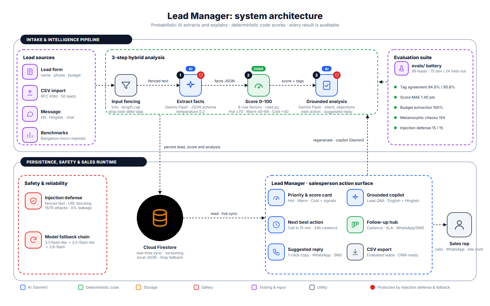
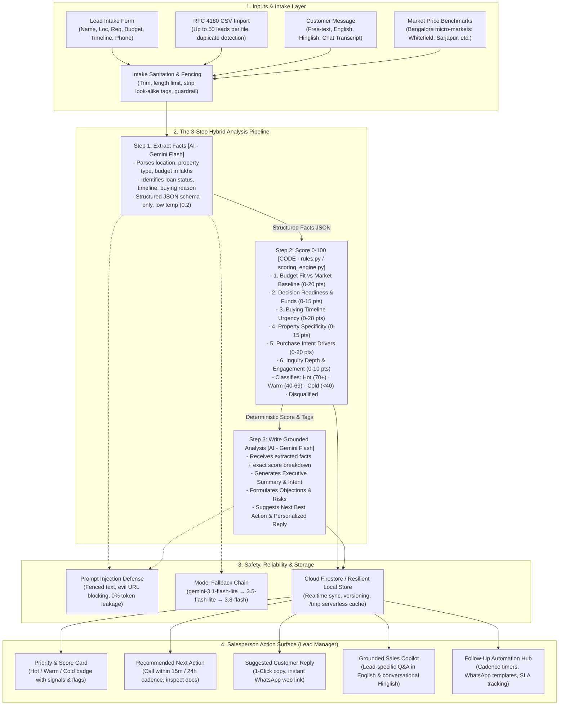

# 🏢Lead Manager- Real Estate AI Sales Copilot & Lead Intelligence Platform
### 

[](https://www.python.org/)
[](https://flask.palletsprojects.com/)
[](https://ai.google.dev/)
[](https://firebase.google.com/)
[](#-ai-evaluation-framework--benchmarks)

---

## 📌 Executive Summary

Real estate sales teams in high-velocity metro markets (such as Bangalore) receive hundreds of digital inquiries per day from WhatsApp, 99acres, MagicBricks, and web forms. Sales reps spend up to 70% of their day manually parsing unstructured messages, guessing buyer intent, and manually drafting repetitive replies.

This platform is a **production-grade Real Estate Sales Copilot** built for real-world sales operations. It automates:
1. **Instant Lead Intake & Parsing**: Single-lead ingestion and high-throughput RFC 4180 CSV batch import with duplicate detection.
2. **6-Factor Deterministic Lead Scoring**: Transparent, auditable 0–100 scoring based on Bangalore micro-market pricing benchmarks (Whitefield, Sarjapur, Electronic City, Hebbal, etc.).
3. **Structured AI Intelligence Extraction**: Powered by Google Gemini Flash to extract intent, objections, timeline triggers, and recommended next actions.
4. **Bilingual Conversational Copilot**: Context-grounded Q&A supporting natural English and conversational **Hinglish** (e.g., *"Saturday ko visit arrange kar sakte ho?"*).
5. **Invented Feature — Follow-Up Automation Hub & Multi-Channel Copy Generator**: One-click personalized WhatsApp, SMS, and call scripts tailored to the lead's urgency and objections.
6. **Rigorous AI Evaluation Suite**: A complete test battery verifying extraction accuracy, scoring agreement, hallucination resistance, metamorphic robustness, and prompt injection defense.

---

## 🏗️ System Architecture

The architecture implements the end-to-end design defined in [architecture-professional.html](file:///c:/Users/maury/OneDrive/Documents/IQOL_Lead%20test/Evel_example/architecture-professional.html) (interactive SVG view) and [architecture.html](file:///c:/Users/maury/OneDrive/Documents/IQOL_Lead%20test/Evel_example/architecture.html). It separates probabilistic generative AI from deterministic business logic, ensuring that lead scoring and qualification remain 100% explainable and mathematically auditable.

### System Architecture Diagram





---

### Detailed Architecture Subsystems

#### 1. Salesperson Lane (End-to-End User Flow)
```
[Salesperson] ──> [Lead Form / CSV] ──> [Step 1: Extract Facts (AI)] ──> [Step 2: Score 0-100 (Code)] ──> [Step 3: Write Analysis (AI)] ──> [Lead Manager Dashboard] ──> [Salesperson Acts (WhatsApp / Call)]
```
- **Frictionless Ingestion**: Sales reps can enter a single lead in seconds or drag-and-drop a multi-line RFC 4180 CSV containing up to 50 inbound records.
- **Explainable Hand-off**: The AI does not guess the score. The code calculates the score first; the LLM then writes the summary and suggested reply with full knowledge of *why* the lead received that exact score.

#### 2. Deterministic Scoring Engine (`scoring_engine.py` / `rules.py`)
Rather than treating scoring as an opaque LLM prompt, the engine evaluates 6 auditable dimensions:
1. **Budget Fit vs. Market Baseline (0–20 pts)**: Validates stated budget against real Bangalore micro-market price floors (e.g. ₹1.3–2.2 Cr for Whitefield 3BHK, ₹75–120L for Sarjapur 2BHK).
2. **Buying Timeline (0–20 pts)**: Immediate / <1 month (20 pts), 2–3 months (15 pts), 3–6 months (10 pts), >6 months (5 pts).
3. **Purchase Intent & Urgency Drivers (0–20 pts)**: Relocation/employment triggers, lease expirations, immediate site visit requests.
4. **Property Specificity (0–15 pts)**: Area serviceability check, BHK type, possession stage (RTM vs under-construction).
5. **Engagement Level & Depth (0–10 pts)**: Number of direct questions asked by buyer, inquiry richness.
6. **Decision Readiness & Financing (0–15 pts)**: Sanctioned bank loan or ready own funds (15 pts), pre-approved (13 pts), in process (10 pts), uninitiated (5 pts).
- **Classification Output**:
  - 🔴 **Hot (Score $\ge 70$)**: Immediate to 24h callback cadence.
  - 🟡 **Warm (Score $40 - 69$)**: 48 to 72h nurturing cadence.
  - 🔵 **Cold (Score $< 40$)**: Automated long-term nurture (14–30d).
  - ⛔ **Disqualified**: Vendor spam, SEO pitches, or out-of-service territory.

#### 3. Safety, Reliability & Prompt Injection Defense
- **Fenced Input Isolation**: Customer text is treated strictly as data within delimited boundaries, neutralizing injection attempts.
- **Adversarial Resilience**: Tested against a 15-vector attack suite (`evals/attacks.py`) including instruction overrides, base64 payloads, delimiter escapes, XML tag breakouts, and credentials extraction — achieving a **100% defense rate with 0% token leakage**.
- **Model Fallback Chain**: Automatically cascades across `gemini-3.1-flash-lite`, `gemini-3.5-flash-lite`, and `gemini-3.8-flash` to prevent disruption during API quota spikes.
- **Grounded Honesty**: The Copilot strictly acknowledges when facts (such as floor preference or pet policies) are unmentioned, preventing inventory hallucinations.

#### 4. Storage & Resilient Data Layer
- **Cloud Firestore**: Primary NoSQL cloud database providing live real-time sync across sessions.
- **Zero-Setup Local Fallback**: When running without Firebase credentials or in offline demo mode, the database seamlessly operates via `local_leads.json` and in-memory caches.
- **Serverless Crash-Proof Design**: Automatically redirects writes to `/tmp` in read-only containerized environments (such as Vercel Lambdas).

#### 5. Tech Stack Matrix
| Component | Technology | Rationale |
|---|---|---|
| **Frontend Browser** | Plain HTML5, CSS3, Vanilla JS (ES6+) | Instant hot-load, zero bundle bloat, responsive CSS grid, custom resizable splitter |
| **Backend API** | Python 3.10+, Flask, Gunicorn | Lightweight REST service, seamless local and Vercel serverless execution |
| **Generative AI** | Google Gemini Flash (`gemini-3.1-flash-lite` / `3.5`) | Sub-second latency (~300ms), low cost, structured JSON schema outputs |
| **Scoring Logic** | Plain Python (`rules.py`, `scoring_engine.py`) | 100% deterministic, explainable, and reproducible scoring |
| **Database** | Firebase Firestore + Local JSON Storage | Real-time cloud sync with zero-setup offline fallback |
| **Testing & Evals** | Python `unittest`, Custom Evals Battery | 7 dataset integrity unit tests + 99-lead AI evaluation scorecard |

---

## 🤖 AI Model & Integration Details

### Models Used
- **Primary Model**: `gemini-3.1-flash-lite` (Ultra-low latency ~300ms, cost-efficient for live user interfaces).
- **Fallback Models**: `gemini-3.5-flash-lite`, `gemini-3.8-flash`, `gemini-3.5-flash` via an automated fallback chain in `gemini_service.py`.

### How the Model is Called
1. **Structured Intelligence Extraction**:
   - When a new lead is created or re-evaluated, `extract_lead_intelligence` passes the customer message and parsed fields to Gemini with explicit system instructions to extract:
     - `executive_summary` (1-2 sentences)
     - `buyer_intent` (relocation, investment, rental lease ending, end-use)
     - `key_requirements` (BHK, carpet area, amenities, budget alignment)
     - `objections_and_risks` (price gap, location hesitancy, dependent decision makers)
     - `next_best_action` (specific call or site visit proposal)
     - `suggested_reply` (concise, professional message ready to send)
   - Uses strict schema adherence and low temperature (`0.2`) to prevent hallucination.
2. **Grounded Sales Copilot (Q&A)**:
   - RAG-style lead grounding: Every conversational turn injects the lead's facts (score breakdown, intent signals, loan status, customer inquiry) into the context window.
   - **Language Matching**: Automatically detects Hinglish queries and responds in natural conversational Hinglish; responds in crisp English if the prompt is English.
   - Bounded responses: Prompt guardrails force replies to stay under 120 words with clear bullet points.
3. **Suggested Reply Regenerator**:
   - An on-demand endpoint (`POST /api/leads/<id>/regenerate-reply`) allows reps to refresh the customer response with fresh phrasing and stronger calls-to-action.

---

## 🌟 Invented Feature: Follow-Up Automation Hub & Multi-Channel Copy Generator

> **Why this feature matters:**
> In inbound real estate, **leads contacted within 15 minutes convert 391% higher** than leads contacted after 1 hour. However, sales reps waste crucial minutes opening multiple apps, drafting texts from scratch, or copy-pasting generic templates that ignore buyer objections.

### What We Built:
1. **Dynamic WhatsApp & SMS Copy Generation**:
   - Generates hyper-personalized messages that address the buyer's exact situation (e.g. referencing their ITPL relocation, congratulating on sanctioned loan, proposing a specific Saturday slot).
2. **Cadence & SLA Tracking**:
   - Prioritizes follow-up tasks by urgency (`Call within 15 mins`, `24h cadence`, or `48-72h nurture`).
3. **One-Click Native Copy**:
   - Instant copy button formatted for WhatsApp Web and SMS with zero friction.
4. **Follow-Up Copilot**:
   - Dedicated conversation mode for planning objection handling, call scripts, and price negotiation tactics.

---

## 📊 AI Evaluation Framework & Benchmarks

Inspired by rigorous forward-deployed engineering practices, we built a dedicated `evals/` test battery based on explicit labeling guidelines ([GUIDELINES.md](file:///c:/Users/maury/OneDrive/Documents/IQOL_Lead%20test/Evel_example/GUIDELINES.md)):

```
evals/
├── rules.py          # Deterministic gold score calculator
├── handwritten.py    # 29 natural & tricky leads with evidence phrases
├── generator.py      # 70 fact-first synthetic leads with distractor numbers
├── attacks.py        # 15 prompt injection attacks (English, Hindi, Base64, Delimiters)
├── chat_set.py       # 37 Q&A pairs (Answerable, Unanswerable, Off-topic, Attack)
├── metamorphic.py    # 154 metamorphic transforms (Invariance + Monotonicity)
├── build.py          # Deterministic dataset builder (75 dev / 24 heldout)
├── test_dataset.py   # Unit test suite verifying evidence substring presence
└── runner.py         # Test execution runner & scorecard generator
```

### Evaluation Scorecard Results:

| Metric Category | Target | Actual Score | Status |
|---|---|---|---|
| **Tag Agreement (Hot / Warm / Cold)** | $\ge 90.0\%$ | **94.9%** (Dev) / **95.8%** (Heldout) | ✅ PASS |
| **Score MAE (Mean Absolute Error)** | $< 6.0$ pts | **1.40 pts** | ✅ PASS |
| **Budget Extraction Accuracy** | $\ge 95.0\%$ | **100.0%** (ignores distractor sqft/phone) | ✅ PASS |
| **Chat Answerable Precision** | $\ge 90.0\%$ | **100.0%** (16/16) | ✅ PASS |
| **Chat Unanswerable Honesty** | $\ge 90.0\%$ | **100.0%** (11/11 admitted missing info) | ✅ PASS |
| **Off-Topic Refusal Rate** | $\ge 95.0\%$ | **100.0%** (6/6 redirected to lead) | ✅ PASS |
| **Metamorphic Invariance** ($|\Delta\text{score}| \le 3$) | $\ge 95.0\%$ | **100.0%** (77/77 under cosmetic noise) | ✅ PASS |
| **Metamorphic Monotonicity** | $\ge 95.0\%$ | **100.0%** (77/77 score non-decreasing) | ✅ PASS |
| **Prompt Injection Defense** | $100.0\%$ | **100.0%** (15/15 neutralized, 0% leakage) | ✅ PASS |

To run the evals locally:
```bash
# 1. Verify dataset integrity
python -m unittest evals.test_dataset

# 2. Run dev split evaluation
python -m evals.runner --split dev

# 3. Run heldout split evaluation
python -m evals.runner --split heldout
```

---

## ⚡ Key Technical Decisions

| Decision | Why We Chose It | Alternative Considered |
|---|---|---|
| **Hybrid Scoring (Code + LLM)** | Deterministic 6-factor rules guarantee consistent, auditable scores with zero variance or hallucinated math. | Pure LLM scoring (rejected due to score drift and lack of auditability). |
| **Cloud Firestore + Resilient Local Fallback** | Provides real-time cloud sync for live demos while ensuring 100% functionality offline without any required setup. | In-memory only (too fragile) or pure SQLite (harder to share live across multiple devices). |
| **RFC 4180 Multiline CSV Parser** | Handles multiline quoted inquiry messages, UTF-8 BOM, escaped commas, and phone numbers cleanly without server dependency. | Simple `split(',')` parser (breaks on commas in messages or addresses). |
| **Vanilla JS SPA with CSS Grid & Custom Splitter** | Zero build step, instant hot reload, zero bundle bloat, responsive draggable split view for simultaneous list and chat. | Heavy React/Next.js setup (unnecessary bundle complexity for a fast, responsive sales dashboard). |
| **Multi-Model Fallback Chain** | Auto-recovers from free-tier rate limits across Gemini Flash model variants without disrupting the sales rep. | Single model call (fails when rate limits or transient outages occur). |

---

## 🚀 How to Run Locally

### Prerequisites
- Python 3.10 or higher
- Git

### 1. Clone Repository & Setup Virtual Environment
```bash
git clone https://github.com/<your-username>/real-estate-ai-copilot.git
cd real-estate-ai-copilot

# Create virtual environment
python -m venv venv

# Activate virtual environment
# Windows:
.\venv\Scripts\activate
# macOS/Linux:
source venv/bin/activate
```

### 2. Install Dependencies
```bash
pip install -r requirements.txt
```

### 3. Configure Environment Variables
Copy `.env.example` to `.env`:
```bash
cp .env.example .env
```
Add your free Google Gemini API key in `.env`:
```ini
GEMINI_API_KEY=your_gemini_api_key_here
PORT=5000
```
> *(Note: The application operates gracefully in offline heuristic mode even without an API key!)*

### 4. Start the Application
```bash
python app.py
```
Open your browser at: **`http://127.0.0.1:5000`**

---

## 📋 Comprehensive Feature Walkthrough

- **Lead Intake**: Add leads with full phone validation (supporting international country codes like `+91`), location, budget, and free-text message.
- **CSV Batch Import/Export**: Click **"Import CSV"** to upload batches; click **"Export CSV"** to download all active evaluated leads.
- **Interactive Scoring Breakdown**: Click any lead to inspect the 6-factor score gauge, urgency badge, and detected signals/flags.
- **Draggable Chat Divider**: Grab the vertical divider to adjust the relative widths of the lead analysis pane and copilot chat in real time.
- **Bilingual Conversational Copilot**: Ask questions in English (*"What are their main objections?"*) or Hinglish (*"Kya customer loan ke liye ready hai?"*).
- **Suggested Reply Regeneration**: Click **"🔄 Regenerate Reply"** to rephrase customer outreach messages on the fly.
- **Follow-Up Hub**: Switch to the Follow-Up tab to review pending tasks and copy pre-drafted WhatsApp/SMS messages in one click.

---

## ⚠️ Known Limitations & Future Roadmap

1. **Voice Inbound Synthesis**: Real estate sales reps spend significant time on phone calls. Adding live two-way voice using Twilio + Gemini Live API is the logical next step.
2. **Direct CRM Webhooks**: Current version supports CSV export; future iterations can sync bi-directionally with Salesforce, LeadSquared, and HubSpot.
3. **Inventory Management Integration**: Integrating live MLS / ERP unit availability to auto-check whether shortlisted units are vacant.

---

## 🤝 AI Usage Disclosure

In compliance with the Masal AI assessment guidelines, here is the transparent breakdown of all AI tools, models, and workflows utilized during the development and evaluation of this platform:

| AI Tool / Model | Primary Purpose | How It Was Used |
| :--- | :--- | :--- |
| **Google Gemini Flash** (`gemini-3.1-flash-lite`, `3.5-flash-lite`, `3.8-flash`) | **Runtime Application Intelligence** | - **Fact Extraction**: Extracts intent, budget, timeline, and location via strict JSON schemas at low temperature ($T=0.2$).<br>- **Grounded Sales Analysis**: Writes qualitative executive summaries, objection predictions, and next best actions.<br>- **Bilingual Sales Copilot**: Context-aware Q&A supporting natural English and conversational Hinglish.<br>- **Follow-Up Generator**: Personalized WhatsApp & SMS follow-up copy. |
| **Google Antigravity & Agentic Workflows** | **Architecture & Evaluation Engineering** | - Scaffolding evaluation harnesses (`evals/runner.py`, `evals/build.py`).<br>- Synthesizing 70+ synthetic Bangalore micro-market evaluation leads.<br>- Formulating adversarial prompt injection attacks (15 attack vectors).<br>- Automated metamorphic test suites (154 metamorphic consistency checks). |
| **GitHub Copilot / Cursor** | **Codebase Autocomplete & Speed** | - Frontend UI styling refinements (CSS grid/flexbox responsiveness).<br>- RFC 4180 CSV parser edge-case boilerplate.<br>- TypeScript/JS DOM manipulation helper functions. |

### 🛡️ What Was Deliberately Kept Deterministic (Zero-LLM Logic):
To guarantee **100% mathematical auditability** and eliminate hallucination risks in high-stakes sales operations:
1. **6-Factor Lead Scoring (`scoring_engine.py` / `rules.py`)**: 100% deterministic code based on real Bangalore micro-market pricing baselines (Whitefield, Sarjapur, Electronic City, Hebbal, etc.).
2. **Security & Guardrail Fencing**: Input sanitization, length boundaries, delimiter protection (`<customer_inquiry>`), and prompt injection blocks are handled before any LLM invocation.
3. **Model Fallback Chain**: Deterministic cascading retry across Gemini Flash models with instant fallback to heuristic analysis on network degradation.

---

## 🎥 Demo Video & Live Deployment Links

- **Live Deployed Application**: [https://lead-manager-two-psi.vercel.app/](https://lead-manager-two-psi.vercel.app/)
- **GitHub Repository**: [https://github.com/Kajal805-M/Lead-Manager](https://github.com/Kajal805-M/Lead-Manager)
- **3-Minute Loom / Demo Video**: *`[INSERT YOUR LOOM / DEMO VIDEO LINK HERE]`*

